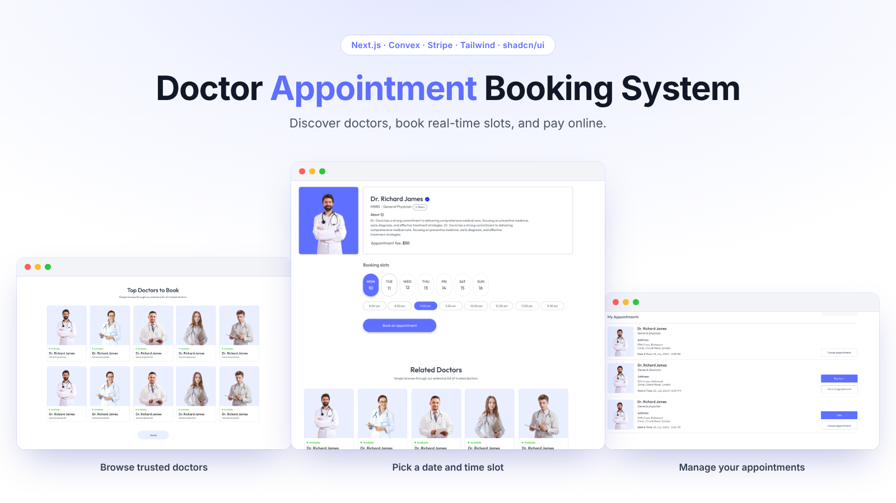

<div align="center">

# 🩺 Doctor Appointment Booking System

**A full-stack platform where patients discover doctors, book real time slots, and pay online — with separate dashboards for admins and doctors.**

[**Live Demo**](https://full-stack-doctor-appointment-booki.vercel.app/) · [**Source Code**](https://github.com/asia272/full-stack-doctor-appointment-booking-system) · [**Figma Design**](https://www.figma.com/design/ZLkjwG5ehxNRrC4SUA2WG7/Prescripto---UI-Design?t=vSXeY6KLW2QA3AQO-0)


<br />



</div>

---

## ✨ Features

nextjs react typescript convex tailwindcss shadcn-ui stripe brevo doctor-appointment-booking appointment-booking full-stack vercel

### 👤 Patients

- Browse trusted doctors on the home page, with live availability status
- View a doctor's profile: specialty, degree, experience, fee, and related doctors
- **Book in seconds:** pick a date and a time slot from the next 7 days. Booked and past slots are disabled in real time
- **My Appointments:** see every booking with its status, and cancel with one click
- Pay online with **Stripe**, or choose to pay cash at the clinic
- Secure sign-up with email verification (one-time code) and a personal profile page

### 🩺 Doctors

- Personal dashboard with their profile and assigned appointments
- Flexible schedule: working hours, slot length, working days, and days off (Sunday off by default)

### 🛡 Administrators

- Secure sign-in with password **plus** an emailed one-time code
- Create and manage doctors, upload profile photos, and switch availability on or off
- Oversee users and appointments from one place

---

## 🔑 Role-Based Access

Every account has one role. What you can see and do depends on it, and the rules are enforced on the server, not just hidden in the interface.

| Role | Who they are | What they can do |
| --- | --- | --- |
| **USER** | Patient | Register, verify email, browse doctors, book, cancel, and pay for their own appointments |
| **DOCTOR** | Doctor | Manage their own profile and view their assigned appointments |
| **ADMIN** | Administrator | Manage doctors, users, and appointments |

| Action | Visitor | USER | DOCTOR | ADMIN |
| --- | :---: | :---: | :---: | :---: |
| Browse doctors and view profiles | ✅ | ✅ | ✅ | ✅ |
| Book an appointment | ❌ | ✅ | ❌ | ❌ |
| View and cancel own appointments | ❌ | ✅ | ❌ | ❌ |
| Doctor dashboard | ❌ | ❌ | ✅ | ❌ |
| Admin panel and doctor management | ❌ | ❌ | ❌ | ✅ |

---

## 🛠 Tech Stack

| Layer | Technology |
| --- | --- |
| Framework | Next.js (App Router), React, TypeScript |
| Backend & Database | Convex (realtime queries, transactional mutations, file storage) |
| UI | Tailwind CSS, shadcn/ui, Sonner toasts, Lucide icons |
| Payments | Stripe Checkout + webhooks |
| Email | Brevo (verification and admin OTP emails) |
| Hosting | Vercel (app) + Convex Cloud (backend) |

---

## 🔐 Security & Reliability

- **Custom authentication** — passwords hashed with Argon2id; sessions stored as SHA-256 hashes, raw tokens live only in `HttpOnly` cookies
- **Role-based access** — `ADMIN`, `DOCTOR`, and `USER` roles enforced on the server, never trusted from the client
- **Internal-only mutations** — sensitive Convex functions are not callable from the browser; they run through a server-side admin client after the session is verified
- **No double booking** — slot checks and inserts run inside a single Convex transaction, so two patients can never take the same slot
- **Clinic time zone logic** — all dates and times are computed in one fixed time zone, so there is no client-timezone drift
- **Hardened admin login** — signed, expiring OTP challenge with attempt limits
- **Fee snapshots** — each appointment stores the fee at booking time, so later price changes never rewrite history

---

## 🚀 Getting Started

### Prerequisites

- Node.js 20+
- A [Convex](https://www.convex.dev/) account
- A [Brevo](https://www.brevo.com/) account (email)
- A [Stripe](https://stripe.com/) account (test mode is fine)

### 1. Clone and install

```bash
git clone https://github.com/asia272/full-stack-doctor-appointment-booking-system.git
cd full-stack-doctor-appointment-booking-system
npm install
```

### 2. Configure environment variables

Create a `.env.local` file in the project root:

```dotenv
# Convex
CONVEX_DEPLOYMENT=dev:<your-deployment>
CONVEX_DEPLOY_KEY=<your-convex-deploy-key>
NEXT_PUBLIC_CONVEX_URL=https://<your-deployment>.convex.cloud
NEXT_PUBLIC_CONVEX_SITE_URL=https://<your-deployment>.convex.site

# App
NEXT_PUBLIC_APP_URL=http://localhost:3000
OTP_HASH_SECRET=<random-string-of-32+-characters>

# Admin (single administrator, signs in with password + emailed code)
ADMIN_EMAIL=<admin-email>
ADMIN_PASSWORD=<strong-password-12+-characters>

# Email (Brevo)
BREVO_API_KEY=<your-brevo-api-key>
BREVO_SENDER_EMAIL=<verified-sender-email>
BREVO_SENDER_NAME=Doctor Appointment Booking System

# Stripe
STRIPE_SECRET_KEY=<sk_test_...>
STRIPE_WEBHOOK_SECRET=<whsec_...>
```

Generate a strong secret with:

```bash
openssl rand -hex 32
```

Set the email variables on Convex as well, because Convex functions send some emails:

```bash
npx convex env set BREVO_API_KEY "<your-brevo-api-key>"
npx convex env set BREVO_SENDER_EMAIL "<verified-sender-email>"
npx convex env set BREVO_SENDER_NAME "Doctor Appointment Booking System"
```

### 3. Run the project

Use two terminals:

```bash
# Terminal 1 — backend (pushes schema and functions)
npx convex dev

# Terminal 2 — frontend
npm run dev
```

Open [http://localhost:3000](http://localhost:3000).

---

## ☁️ Deployment

1. Deploy the backend to production: `npx convex deploy`
2. Import the repo into [Vercel](https://vercel.com/) and add every variable from `.env.local`, using **production** Convex and Stripe values
3. Set `NEXT_PUBLIC_APP_URL` to your live domain
4. In the Stripe dashboard, add a webhook endpoint at `https://<your-domain>/api/stripe/webhook` and copy its signing secret into `STRIPE_WEBHOOK_SECRET`

> ⚠️ Never commit `.env.local`. Keep it listed in `.gitignore`, and rotate any key that has been shared publicly.

---

## 🗺 Roadmap

- [ ] Appointment reminders by email
- [ ] Doctor-side confirm / reject / complete actions
- [ ] Reschedule an existing appointment
- [ ] Reviews and ratings
- [ ] Search and filter doctors by specialty

---

## 👩‍💻 Author

Built by **[@asia272](https://github.com/asia272)**.

If this project helped you, consider giving it a ⭐ on [GitHub](https://github.com/asia272/full-stack-doctor-appointment-booking-system).